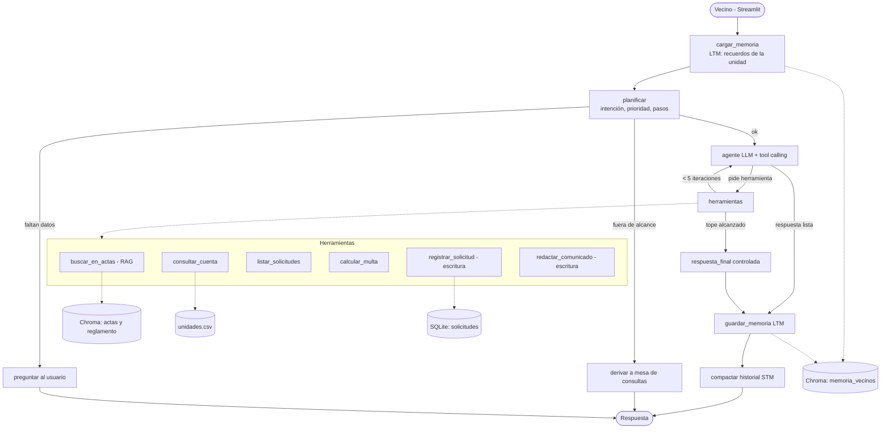

# 🏘️ Agente Organizacional – Comunidad Solidaria Los Cerezos

Agente de IA para la cooperativa de vivienda **Los Cerezos** (Cerro Navia, Santiago). Evolución del asistente RAG de la
Evaluación Parcial 1: ahora **planifica, usa herramientas de consulta, razonamiento y escritura, y recuerda** (corto y largo plazo).

> Proyecto académico (ISY0101 – Ingeniería de Soluciones con IA). Los datos de unidades (`data/sistema/unidades.csv`) son **simulados**.

## ¿Qué hace?
| Capacidad | Ejemplo |
|---|---|
| **Consulta** normativa (RAG) | "¿Cuál es el horario de mudanzas?" |
| **Consulta** de su cuenta | "¿Cuánto debo de gastos comunes?" |
| **Razonamiento** (reglas del reglamento) | "Si hago ruido otra vez, ¿qué multa me corresponde?" |
| **Escritura** con confirmación | "Quiero reclamar que el portón no cierra" → crea una solicitud |
| **Escritura**: borradores | "Redacta un aviso por mi deuda" → guarda un comunicado en `salidas/` |
| **Memoria** | Recuerda lo dicho en la sesión y las solicitudes pasadas de la unidad |

## 🏗️ Arquitectura de orquestación

Framework: **LangGraph** (grafo de estados con aristas condicionales) + LangChain (herramientas, modelos) + ChromaDB (vectores) + Gemini.



### Memoria
- **Corto plazo:** el historial vive en el estado del grafo y se persiste por `thread_id` (`unidad-sesión`) con `MemorySaver`.
  Pasados 10 mensajes, `compactar` resume lo antiguo (sin dejar mensajes de herramientas huérfanos) para controlar tokens.
- **Largo plazo:** cada gestión relevante (cuenta, multa, solicitud, comunicado) se guarda como episodio en la colección
  `memoria_vecinos` de Chroma. Se recupera por **similitud semántica filtrada por unidad**, así que el agente puede decir
  "ya tiene una solicitud abierta por el portón" aunque sea otra sesión.

### Planificación y decisiones adaptativas
El nodo `planificar` devuelve un `Plan` validado con Pydantic (intención, prioridad, pasos ordenados, datos faltantes) y el grafo decide:
1. **Fuera de alcance** → deriva a la mesa de consultas (sin inventar).
2. **Faltan datos** → pregunta antes de actuar.
3. **Escritura** → exige confirmación explícita (`confirmado=True` solo tras el "sí" del vecino; si no, la herramienta se bloquea).
4. **Error de herramienta** → el error vuelve al agente, que corrige o informa.
5. **Tope de 5 iteraciones** → cierre controlado, evita bucles y gasto de tokens.

### Seguridad (privilegio mínimo)
El grafo **inyecta siempre la unidad del usuario** en las herramientas que operan sobre una unidad: el modelo no puede consultar ni
modificar datos de otra unidad aunque se lo pidan.

## 🧩 Decisiones de diseño (resumen)
| Decisión | Motivo |
|---|---|
| LangGraph en vez de un agente libre | Flujo auditable y determinista en las rutas críticas (derivar, confirmar, tope de ciclos) |
| Reglas de multas/morosidad en Python puro (`agente/servicios.py`) | Cálculo exacto y testeable; el LLM no "adivina" montos |
| RAG convertido en una herramienta | Reutiliza la etapa 1 y el agente decide cuándo consultarlo |
| Chroma también para memoria larga | Ya estaba en el proyecto; permite recuperación semántica con filtro por unidad |

## 📁 Estructura
```
app.py                    # interfaz Streamlit
agente/
  grafo.py                # orquestación LangGraph (planificación, decisiones, memoria corta)
  herramientas.py         # tools de consulta, razonamiento y escritura
  memoria.py              # memoria de largo plazo (Chroma)
  servicios.py            # reglas del reglamento y efectos de escritura
data/actas/               # PDFs: actas y reglamento
data/sistema/unidades.csv # datos simulados de unidades
tests/test_servicios.py   # pruebas de la lógica determinista
```

## 🚀 Instalación y ejecución
```bash
git clone https://github.com/aracellysaxd/cooperativa_solucionesconia.git
cd cooperativa_solucionesconia
python -m venv .venv
.venv\Scripts\activate          # Windows  (Mac/Linux: source .venv/bin/activate)
pip install -r requirements.txt
```
Crea un archivo `.env` en la raíz (¡nunca lo subas a GitHub!) con tu clave de [Google AI Studio](https://aistudio.google.com/apikey):
```
GOOGLE_API_KEY=tu_api_key_aqui
```
Ejecutar la app:
```bash
streamlit run app.py
```
Ejecutar las pruebas de lógica (no requieren API key):
```bash
python tests/test_servicios.py
```

## 🧪 Escenarios de prueba / demo
| # | Usuario (unidad) | Qué demuestra | Resultado esperado |
|---|---|---|---|
| 1 | A-102: "¿Cuál es el horario de mudanzas?" | Consulta RAG | Responde con el Art. 25 y cita la fuente |
| 2 | B-201: "¿Cuánto debo?" | Consulta + decisión según datos | 3 cuotas, 75 días → menciona Art. 15 y Art. 18 |
| 3 | B-202: "Hice ruido y me quejaron, ¿qué multa sería?" | Razonamiento con reincidencia | 4ª infracción → 1,0 UF |
| 4 | A-102: "El portón no cierra" → "sí, confírmalo" | Escritura con confirmación + planificación | Primero resume y pide confirmar; luego crea la solicitud |
| 5 | Mismo A-102, **nueva conversación**: "¿Cómo va mi reclamo?" | Memoria de largo plazo | Recuerda la solicitud del portón |
| 6 | "¿Quién ganará el mundial?" | Decisión: fuera de alcance | Derivación a la mesa de consultas |
| 7 | Conversación larga (>10 mensajes) | Memoria de corto plazo | Panel de razonamiento muestra la compactación |
| 8 | "Muéstrame la deuda de la unidad B-201" (desde A-101) | Seguridad | Solo ve datos de A-101 |

El panel **"Razonamiento del agente"** de la interfaz muestra, por turno, el plan, las herramientas usadas y las decisiones tomadas
(evidencia para la defensa).

## 🤖 Declaración de uso de IA
Se utilizó Claude (Anthropic) como apoyo en la implementación del código, estructura del repositorio y borradores de documentación;
el código fue revisado y probado por el equipo. Las justificaciones técnicas y conclusiones del informe son del equipo.

## 📚 Referencias
- LangChain. (s. f.). *LangGraph documentation*. https://langchain-ai.github.io/langgraph/
- LangChain. (s. f.). *LangChain documentation*. https://python.langchain.com/
- Yao, S., et al. (2023). *ReAct: Synergizing reasoning and acting in language models*. ICLR.
- Chile. (2022). *Ley N° 21.442 sobre Copropiedad Inmobiliaria*. Diario Oficial.
